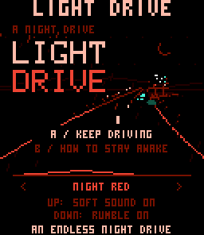

# Light Drive

A quiet, endless night drive for the **CHGame Rev0** handheld.



Sleep narrows your vision while your foot gets heavier. Brake with **B**,
follow neon arrows to wake up, and watch for wildlife. Four night palettes,
soft buzzer sounds and optional rumble. Your best distance stays on the SD card.

**Controls:** ←/→ steer · A start/retry · B brake · Select palette · Start pause.

Install the [CHGame board package](https://github.com/bateske/CHGame#-get-started),
then open `LightDrive.ino` in Arduino IDE, or build with `arduino-cli`:

```sh
git clone https://github.com/juliendorra/light-drive.git LightDrive
cd LightDrive
arduino-cli compile --fqbn CHGame:ch32v:rev0:opt=oslto,rtlib=nano,periph=game,usb=uploadonly --output-dir build .
```

Game source and original [pixel artwork](art/) are MIT licensed.
Visual inspiration: [Kravennart’s “Night drive, 4 colors”](https://www.reddit.com/r/PixelArt/comments/1xkeudl/night_drive_4_colors/).
